<div align="center">


# VeltOS

**Your PC. No Limits.**

*Senin Bilgisayarın. Sınır Tanıma.*

A free, Debian-based desktop operating system that looks and works the way
Windows 11 users already know, with its own apps, a modern installer and
Windows program support through Wine.

**[⬇ Download VeltOS 1.0](https://github.com/AhmetFurkanDEMIR/VeltOS/releases/tag/v1.0)** ·
[Website](https://veltos.ahmetfurkandemir.com/) ·
[Project status](docs/dev/status.md) ·
[Build guide](docs/dev/build-guide.md) ·
[Architecture](docs/dev/architecture.md) ·
[Contributing](CONTRIBUTING.md)


</div>

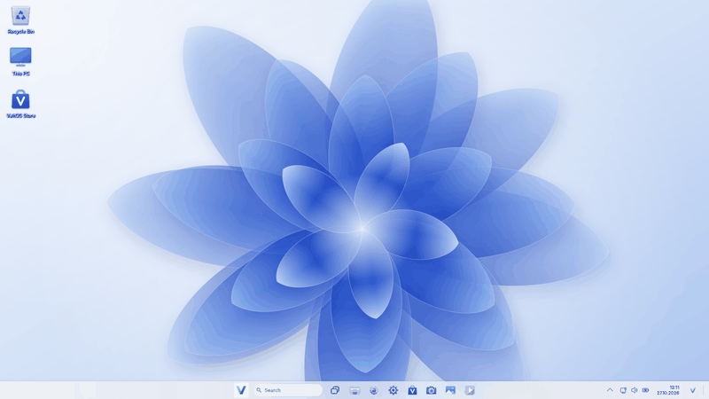

> [!NOTE]
> **VeltOS 1.0 is the first public release.** Every ISO goes through
> automated start-up and installation tests with UEFI, BIOS and Secure Boot,
> and VeltOS 1.0 has been installed on a laptop with NVIDIA graphics.
> [docs/dev/status.md](docs/dev/status.md) lists exactly what works and how
> it was tested. As with any new system, back up your files before you
> install it.

## Highlights

- **Windows 11's desktop, on Linux.** A centred taskbar, Start with pinned
  apps and recommendations, search as you type, Task View with virtual
  desktops, Quick Settings with power modes, battery-aware profile
  selection and a mobile hotspot, the notification centre and the right-click menus you know, on
  KDE Plasma 6.3 (Wayland).
- **Apps written for VeltOS.** File Explorer, Settings, Store, Notepad,
  Calculator, Photos, Media Player and more, each in the layout of its
  Windows 11 counterpart, in English and Turkish, light and dark.
- **Office and Mail.** Microsoft 365's start screen in front of LibreOffice
  (Word, Excel and PowerPoint, saving in Microsoft's formats by default) and
  VeltOS Mail in the layout of the new Outlook (IMAP and SMTP).
- **Windows programs with a double click.** `.exe` and `.msi` files install
  through Wine into one Windows environment and appear in Start and in
  Settings › Apps. Wine does not run every program and is not a security
  sandbox; VeltOS says so.
- **A modern installer.** Calamares with VeltOS' own pages in the style of
  Windows 11's setup. It follows the live system's light or dark mode and
  accent colour, and offers disk encryption that asks for the password at
  start-up, like BitLocker.
- **Automatic Repair.** When VeltOS does not finish starting twice in a row,
  the PC opens a repair screen with Startup Repair, Safe mode, Command Prompt
  and the last start's problems. No boot menu at start-up: F1 shows it,
  F6 opens Recovery.
- **VeltOS AI.** An assistant pane like Copilot's (Windows + C) with
  ChatGPT, Claude, Gemini or Copilot on your own key, or a free model that
  runs on the PC; it changes settings only after you allow it.
- **Safe and light by default.** Software comes only from Debian's signed
  archives or is built from this repository. AppArmor is on, and the ISO
  boots with Secure Boot through Debian's signed shim. Every background
  service has to earn its place, start-up times are measured for every ISO,
  and memory is compressed (zram) as on Windows 11.

## Screenshots

Every picture was taken on VeltOS 1.0; VeltOS has a light and a dark look.

| | |
|:---:|:---:|
| 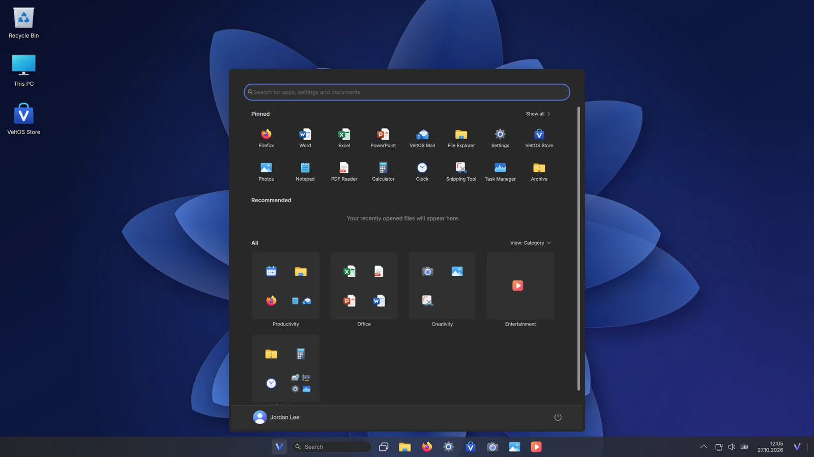 | 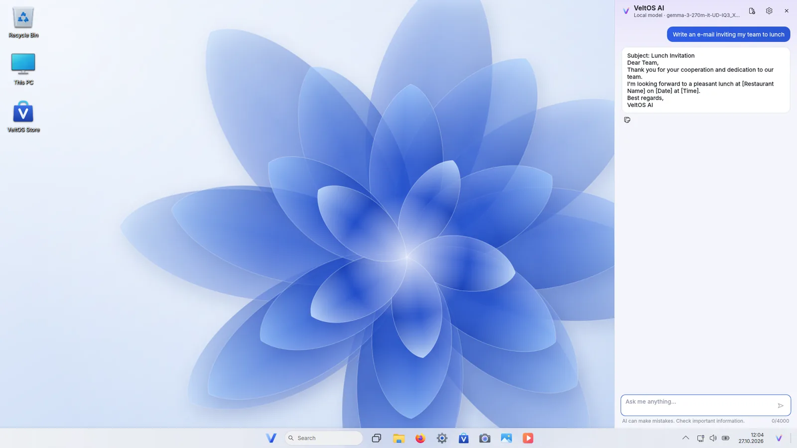 |
| Start in dark mode | VeltOS AI with the free local model |
|  | 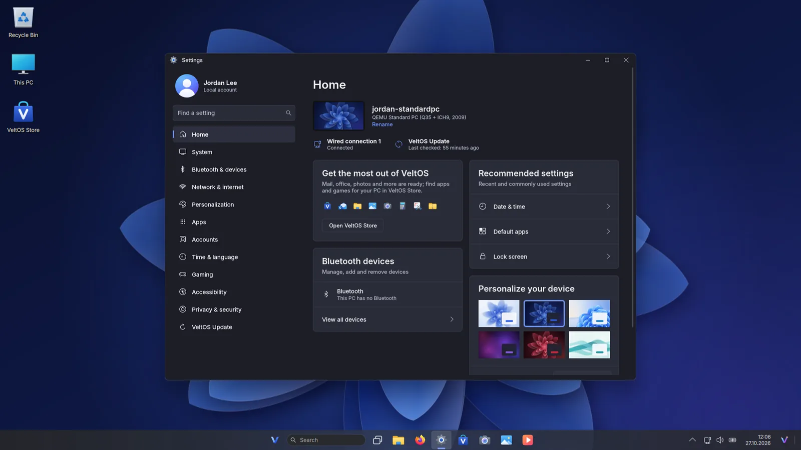 |
| File Explorer with tabs | Settings in Windows 11's layout |
| 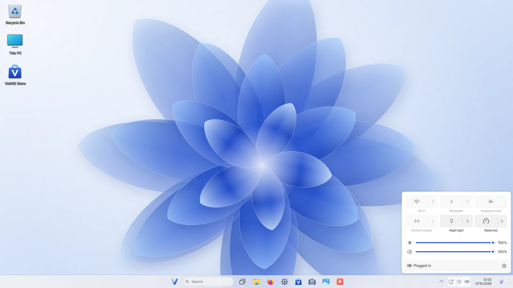 | 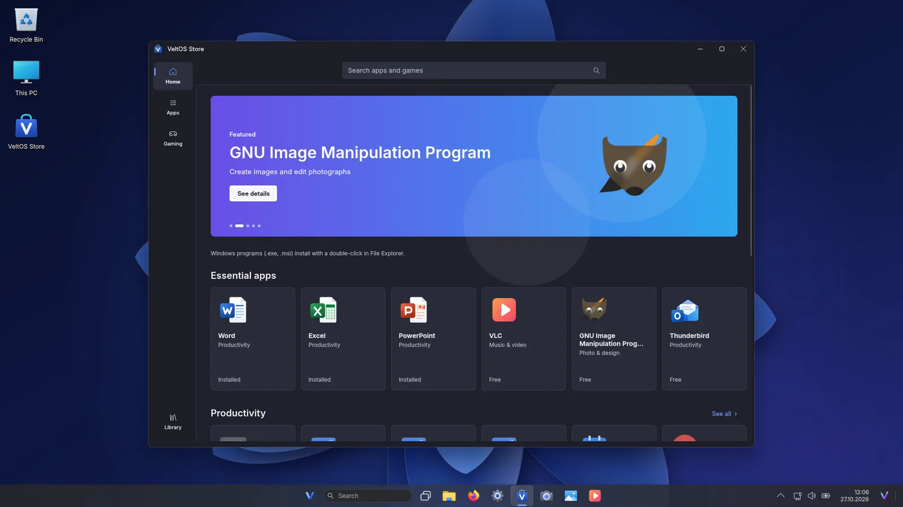 |
| Quick Settings on the taskbar | VeltOS Store on Debian's archive |
| 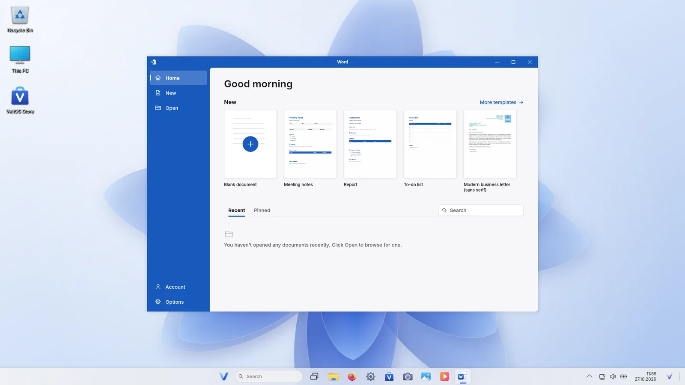 | 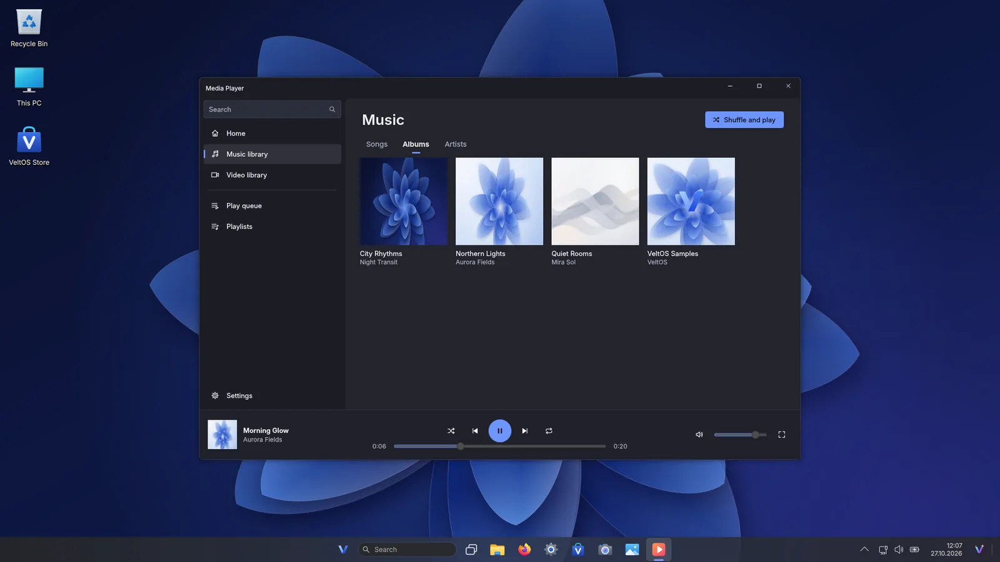 |
| Word's start screen, LibreOffice behind it | Media Player with albums |
| 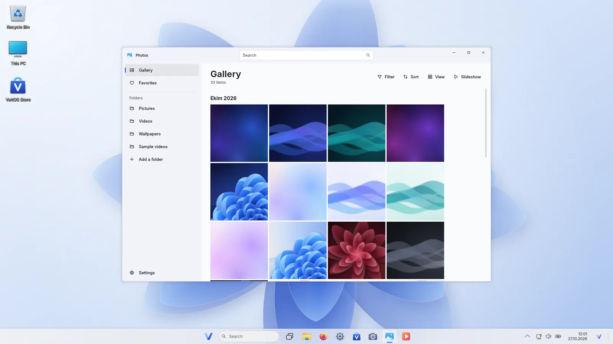 | 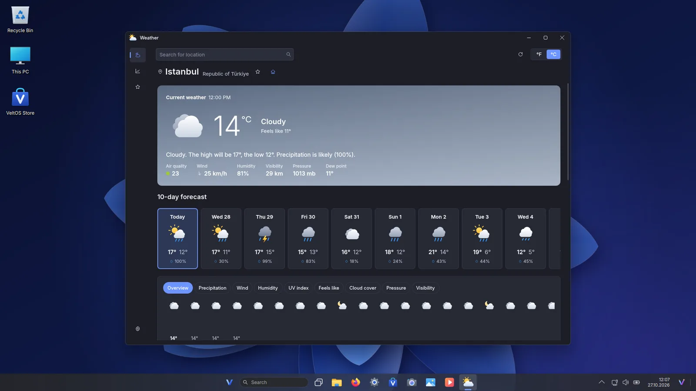 |
| Photos by month | Weather without an account |
| 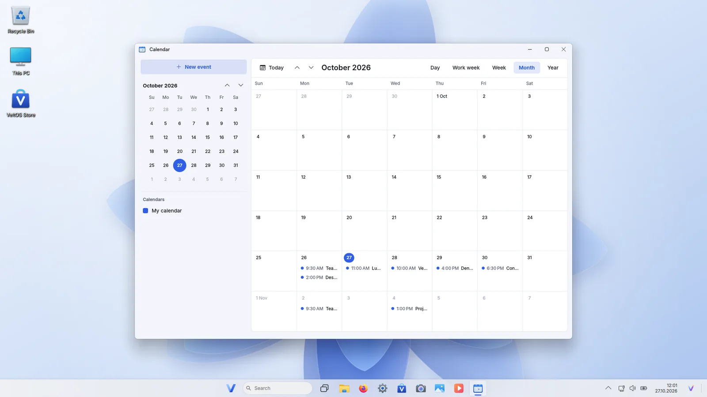 | 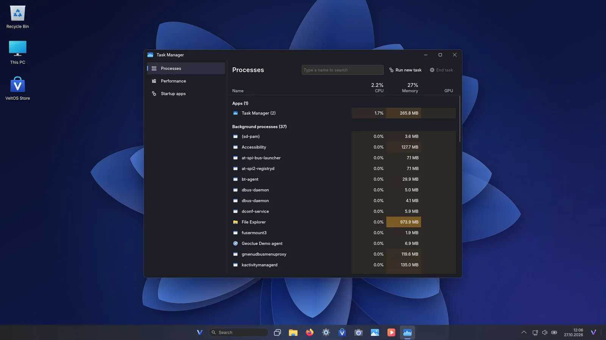 |
| Calendar | Task Manager |

**From power on to the desktop:** the start screen (F1 boot menu, F6
Recovery), the sign-in screen and the desktop.

| | | |
|:---:|:---:|:---:|
|  | 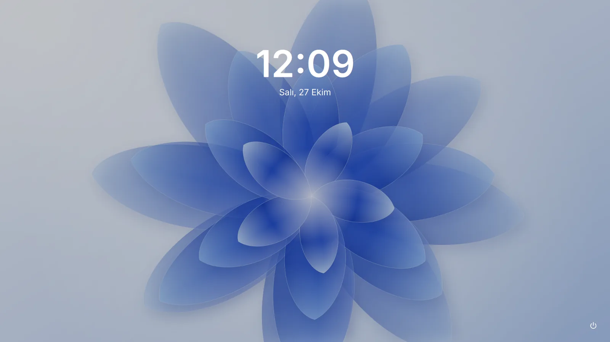 | 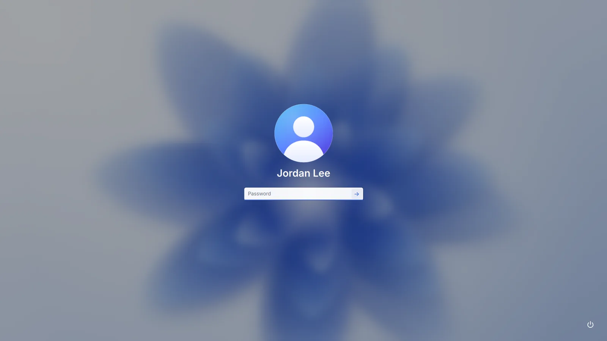 |
| Start screen | Sign-in screen | Your account |
|  | 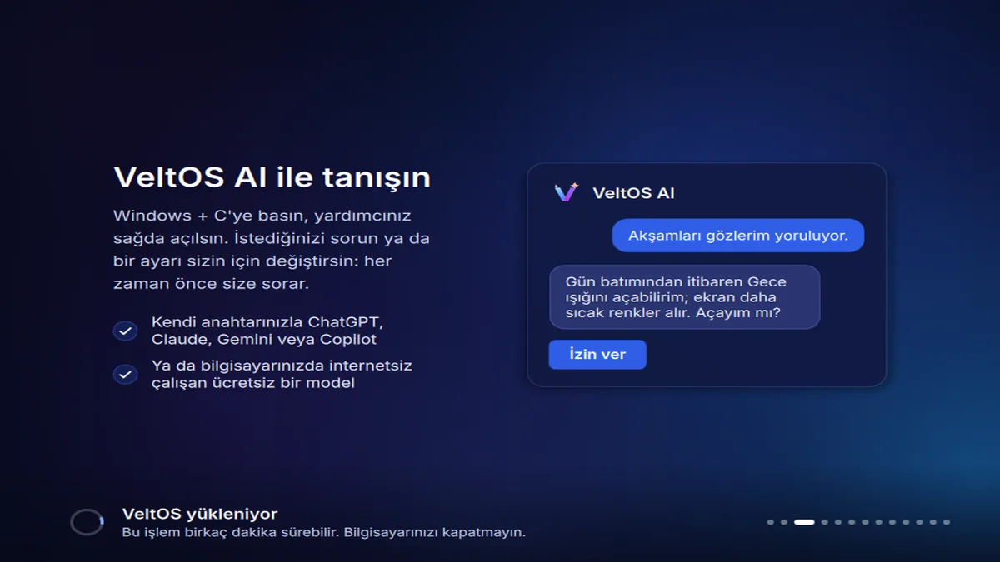 | 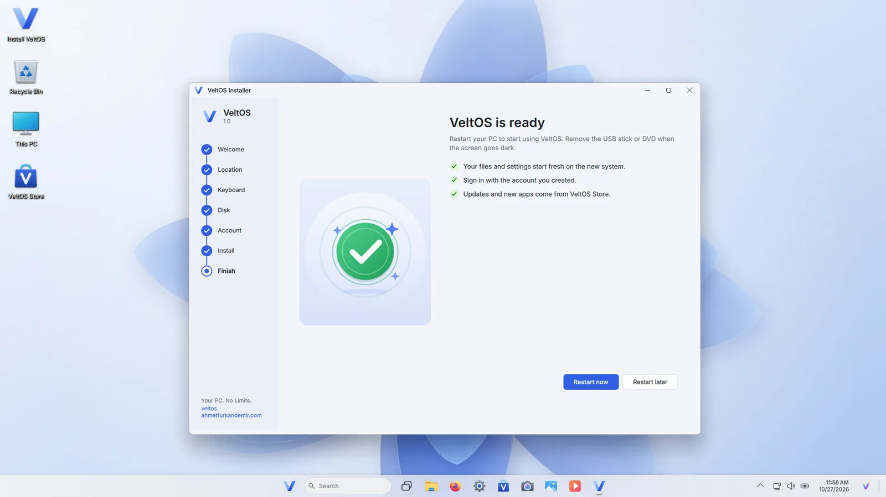 |
| The installer | Slides while it installs | Done |

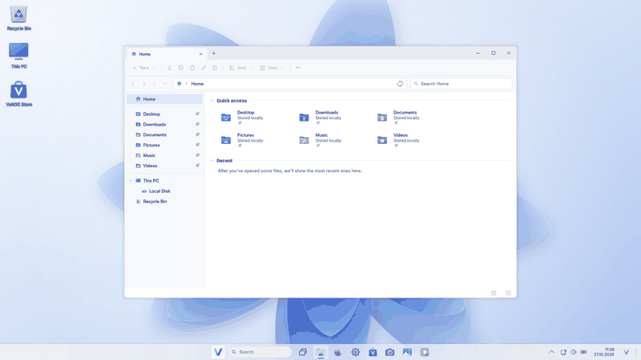

More on the [website](https://veltos.ahmetfurkandemir.com/#gallery).

## What's inside

| VeltOS | Like Windows 11's | Built on |
|---|---|---|
| File Explorer | File Explorer, file dialogs, "Open with", the copy window, drive formatting and desktop shortcuts from Explorer, Start and Search | KIO, UDisks2 |
| Settings | Settings, including Mobile hotspot (share the internet connection over Wi-Fi) | NetworkManager, BlueZ, PipeWire, KScreen, power-profiles-daemon |
| Store | Microsoft Store | AppStream, PackageKit |
| Word, Excel, PowerPoint | Microsoft 365's start screen | LibreOffice 25.2 |
| Mail | Outlook (the new Outlook's layout) | Python's imaplib/smtplib, Qt WebEngine |
| Calendar, Clock, Calculator, Notepad | The apps of the same name | Qt Quick |
| Maps | Google Maps in a VeltOS window, with optional location access | Qt WebEngine, GeoClue |
| Weather | Weather (current weather, 10-day and hourly forecast, details, history, favorites) | Open-Meteo's open data, no key |
| VeltOS AI | Copilot's pane and taskbar button (Windows + C), acting on the PC after "Allow" | ChatGPT, Claude, Gemini or Azure OpenAI with your own API key |
| Photos, Media Player, Camera | The apps of the same name | Pillow, Qt Multimedia |
| Snipping Tool | Snipping Tool (Print Screen, Win+Shift+S) | Spectacle |
| PDF Reader | A modern PDF reader | Qt PDF |
| Archive | WinRAR's layout | 7-Zip, bsdtar |
| Task Manager, Disk Management | The tools of the same name | psutil, UDisks2 |
| Graphics Cards | Settings' graphics pages and Device Manager's display adapters | lspci, Mesa, PackageKit |
| Administrator prompt | User Account Control | polkit |
| Windows programs | App Installer | Wine 10.0, DXVK 2.6 |
| Automatic Repair | Automatic Repair | systemd, GRUB |
| Installer | Windows Setup | Calamares 3.3 |

All VeltOS apps are Python 3 and Qt Quick (PySide6), packaged as small
Debian packages under [packages/](packages/). Firefox ESR is the web browser.

## Download and install

| | |
|---|---|
| ISO | [VeltOS-1.0-amd64.iso](https://github.com/AhmetFurkanDEMIR/VeltOS/releases/download/v1.0/VeltOS-1.0-amd64.iso) (2.1 GB, 64-bit) |
| SHA-256 | `3e5273a13b0f87a11bd6a3fb668674b02c5865264065dfe5e570387f4ac1a2af` |
| Release notes | [GitHub release v1.0](https://github.com/AhmetFurkanDEMIR/VeltOS/releases/tag/v1.0) |

1. Download the ISO and check it: `sha256sum VeltOS-1.0-amd64.iso` (Linux)
   or `Get-FileHash VeltOS-1.0-amd64.iso` (PowerShell).
2. Write it to a USB stick of 4 GB or more with Rufus or balenaEtcher.
3. Start the PC from the stick (its boot menu key is often F12, F11 or
   Esc). VeltOS starts as a live system; look around first.
4. Select "Install VeltOS": next to Windows, in its place or on free
   space, with optional disk encryption. Back up your files first, as with
   any new system.

The PC needs a 64-bit Intel or AMD processor, 2 GB of memory (4 GB or more
recommended), 20 GB of storage and UEFI (Secure Boot on or off) or BIOS.
The live session signs in by itself (user `velt`, password `live`). After
installing, there is no boot menu: press F1 while the PC starts to choose
another system, F6 for Recovery.

## Build from source

Everything builds and is tested inside a Docker container; the host needs
only Docker and bash.

| You need | |
|---|---|
| Docker | Docker Engine on Linux, Docker Desktop on Windows and macOS (privileged containers) |
| bash | Git Bash on Windows |
| Disk | About 25 GB free |
| Memory | 8 GB; 16 GB is better |
| KVM | For the boot tests (`build/run.sh test`) |

```bash
git clone https://github.com/AhmetFurkanDEMIR/VeltOS.git
cd VeltOS
build/run.sh iso      # build every package (with its unit tests) and the ISO into out/iso/
build/run.sh test     # boot the newest ISO in QEMU/KVM with UEFI and check the desktop
```

| Command | What it does |
|---|---|
| `build/run.sh packages [name...]` | Build VeltOS' Debian packages and run their unit tests |
| `build/run.sh iso` | Build the packages and the live ISO |
| `build/run.sh test [uefi\|bios\|secureboot]` | Boot the newest ISO in QEMU/KVM, check it and take screenshots |
| `build/run.sh test-winapps` | Install a real Windows program through VeltOS' runner in a VM |
| `build/run.sh vm start` | A long-running development VM (`do`, `exec`, `upload`, `stop`) |
| `build/run.sh shell` | A shell in the builder container |

Options, mirrors and troubleshooting are in the
[build guide](docs/dev/build-guide.md).

## Under the hood

| | |
|---|---|
| Base | Debian 13 "trixie" (stable) |
| Kernel | Linux 6.12 LTS, Debian's signed kernel |
| Desktop | KDE Plasma 6.3 on Wayland, with VeltOS' taskbar, Start, Task View and window frames |
| Graphics | Mesa 25.0; NVIDIA's driver from Debian with one button (Graphics Cards) |
| Boot | GRUB 2.12 for BIOS and UEFI, Secure Boot through shim, Plymouth |
| Installer | Calamares 3.3.14 with VeltOS' pages |
| Office, web, mail | LibreOffice 25.2, Firefox ESR, VeltOS Mail (IMAP/SMTP) |
| Windows programs | Wine 10.0, DXVK 2.6, Wine Mono and Gecko |
| VeltOS apps | Python 3.13, PySide6 6.8 (Qt Quick) |
| Languages | English and Turkish |
| ISO | 2.11 GB (under 2 GiB), one hybrid image for USB sticks and DVDs (VeltOS 1.0, 2026-10-27) |

VeltOS reuses mature upstream software instead of forking it: Debian
packages, KDE Plasma, Mesa, Wine and Calamares are used as they are and
changed through configuration, themes and small VeltOS packages. The
reasons, the alternatives and their trade-offs are in
[docs/dev/architecture.md](docs/dev/architecture.md).

## Quality and testing

- **Unit tests in every package build.** Each package runs its tests while it
  builds (1055 tests in the 2026-10-27 build of VeltOS 1.0).
- **The image checks itself.** A live-build hook stops the build when a VeltOS
  invariant is broken: required packages, branding, themes, file
  associations, the boot splash, stripped Wine libraries and more.
- **Boot tests for every ISO.** Each ISO starts with UEFI, BIOS and Secure
  Boot in automated tests that check the desktop, look for crashes and core
  dumps and record screenshots, memory use and start-up times.
- **Install tests.** Installations (offline, encrypted, English and
  Turkish) are started again from the installed disk; VeltOS 1.0 was also
  installed on a laptop with NVIDIA graphics.
- **Evidence in the repository.** Reports and screenshots of milestone test
  runs are kept in [tests/results/](tests/results/).

What is not tested yet is listed in
[docs/dev/status.md](docs/dev/status.md) and
[docs/dev/testing.md](docs/dev/testing.md).

## Project principles

VeltOS is built by people and AI agents together under a short set of rules;
the full text is in [AGENTS.md](AGENTS.md).

1. Working, bootable software comes before ambitious unimplemented features.
2. No fabricated results: untested means untested, and failures are reported
   with their output.
3. Reuse mature upstream components; VeltOS' own code lives in small, tested
   Debian packages.
4. Security, reliability and low resource use are requirements.
5. No promises of universal Windows compatibility or "native performance"
   without measurements.
6. Builds and tests stay inside containers, away from the developer's
   system.
7. Everything in the repository is in English, and the documentation is kept
   current so that anyone can continue the work.

## Repository layout

| Path | Contents |
|---|---|
| [AGENTS.md](AGENTS.md) | Rules, repository map and lessons learned, for contributors and AI agents |
| [build/](build/) | `run.sh` (the single entry point), the builder container, the live-build configuration |
| [packages/](packages/) | VeltOS' Debian packages, one per directory |
| [tests/](tests/) | VM boot, install and Windows program tests; committed test evidence |
| [docs/](docs/) | The website (GitHub Pages) |
| [docs/dev/](docs/dev/) | Developer documentation |

## Documentation

| Document | What it covers |
|---|---|
| [Project status](docs/dev/status.md) | What is done, how it was tested, known gaps and next steps |
| [Architecture](docs/dev/architecture.md) | Technical decisions with alternatives and trade-offs |
| [Build guide](docs/dev/build-guide.md) | Building and testing, step by step |
| [Testing](docs/dev/testing.md) | Test strategy, measurements and their limits |
| [Development log](docs/dev/development-log.md) | Everything that was done, in order, with results |

## Contributing

Bug reports and pull requests are welcome. Read [CONTRIBUTING.md](CONTRIBUTING.md)
and [AGENTS.md](AGENTS.md) first, and report problems on
[GitHub Issues](https://github.com/AhmetFurkanDEMIR/VeltOS/issues).

## License and trademarks

VeltOS' code is licensed under the GNU General Public License v3.0 or later
([LICENSE](LICENSE)); VeltOS' artwork is licensed under CC BY-SA 4.0. Debian
and the upstream components keep their own licenses.

VeltOS is an independent project and is not affiliated with or endorsed by
Microsoft. Windows, Microsoft 365, Word, Excel, PowerPoint and Outlook are
trademarks of Microsoft Corporation; they are named only to describe what
VeltOS resembles.
